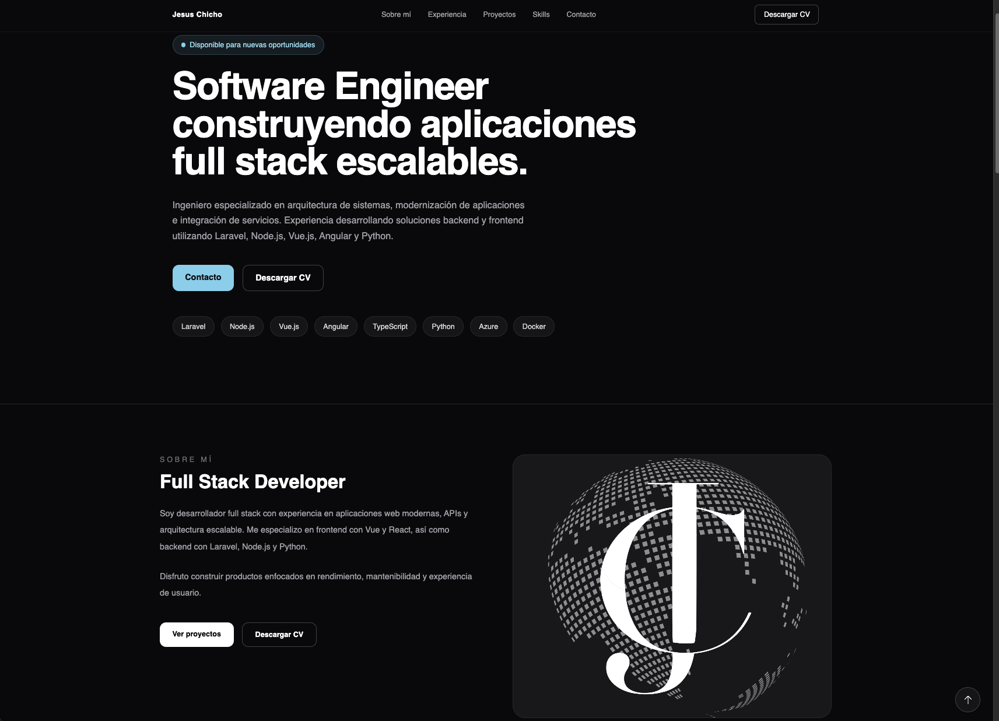
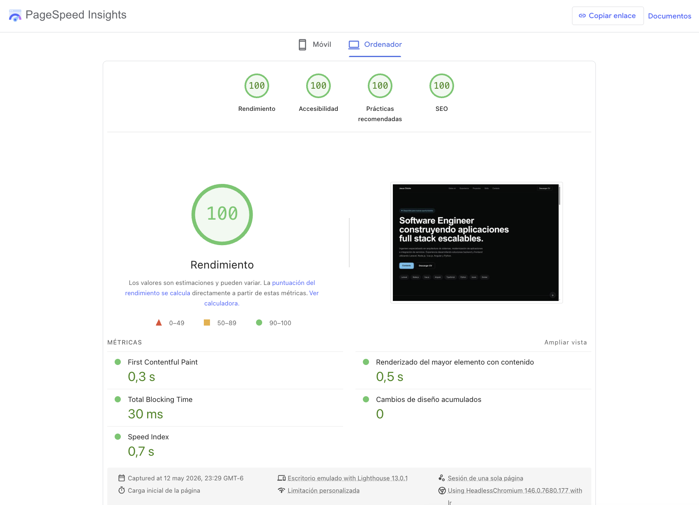

# Portafolio Personal (Nuxt 4)

## Descripción

Este proyecto es un portafolio personal desarrollado con **Nuxt 4, Vue 3 y TailwindCSS**, enfocado en mostrar experiencia profesional, proyectos y habilidades como Ingeniero de Software Full Stack.

Representa una evolución desde una versión previa en HTML/CSS/JavaScript hacia una arquitectura moderna basada en componentes, mejorando escalabilidad, mantenibilidad y rendimiento.

## Sitio en vivo

[chichohdz.com](https://chichohdz.com)

El dominio anterior de Netlify redirige al dominio actual mediante `netlify.toml`.

## Stack tecnológico

- Nuxt 4
- Vue 3
- TypeScript
- TailwindCSS
- Netlify

## Características principales

- Arquitectura modular basada en componentes reutilizables
- Diseño responsive (mobile-first)
- Optimización SEO (meta tags, Open Graph, Twitter Cards)
- Mejora en performance y organización del proyecto
- UI limpia enfocada en UX
- Deploy automático en Netlify (CI/CD)
- Perfil técnico en `/` y presentación de servicios en `/services`
- CV con previsualización, descarga directa y apertura en otra pestaña
- Avisos de privacidad/cookies y control de Analytics mediante elección opcional

## Documentación y contexto para IA

| Documento | Contenido |
|---|---|
| [AGENTS.md](./AGENTS.md) | Entrada común para asistentes: fuentes de verdad, flujo de trabajo y validación |
| [Estado](./docs/project/STATUS.md) | Trabajo entregado, tarea activa y pendientes |
| [Mantenimiento](./docs/project/MAINTENANCE.md) | Plan de dependencias, diagnóstico y próximas mejoras por rama |
| [Arquitectura](./docs/architecture/README.md) | Rutas, componentes, CV, módulos y alojamiento |
| [Despliegue](./docs/deployment/README.md) | Revisión previa, previews y promoción a producción |
| [Privacidad](./docs/privacy/README.md) | Inventario técnico y controles implementados |
| [Cuentas](./docs/privacy/ACCOUNT-CHECKLIST.md) | Ajustes confirmados de GA4/Netlify y comprobación real tras desplegar |
| [Revisión de privacidad](./docs/privacy/REVIEW.md) | Evaluación de textos, decisiones y pendientes jurídicos |
| [Pruebas](./docs/testing/README.md) | Pruebas unitarias, integración reproducible y capturas de evidencia |

`CLAUDE.md` y `GEMINI.md` remiten a `AGENTS.md`. La documentación de privacidad describe los controles implementados, sus confirmaciones y límites de verificación; no sustituye al aviso público.

## Estructura del proyecto

```
app/
├── components/
│   ├── layout/
│   ├── privacy/
│   ├── sections/
│   ├── services/
│   └── ui/
├── composables/
├── pages/
├── plugins/
├── utils/
├── layouts/
├── assets/
└── app.vue

public/           PDF del CV, capturas y otros recursos públicos
docs/             arquitectura, estado, privacidad, pruebas y documentación en inglés
tests/            pruebas unitarias de preferencias con node:test
scripts/          comprobación de privacidad con Chrome y etiqueta simulada
nuxt.config.ts    módulos, SEO, dominio y preset de Nitro
netlify.toml      redirección del dominio anterior
```

## Objetivo del rediseño

- Migrar de HTML/CSS/JS a un framework moderno (Nuxt)
- Mejorar mantenibilidad y escalabilidad del código
- Optimizar estructura de componentes
- Mejorar experiencia de usuario y consistencia visual

## Capturas del proyecto

### Antes (versión HTML/CSS/JS)


### Después (Nuxt 4)



## Verificar rendimiento

Analiza el dominio actual en [PageSpeed Insights](https://pagespeed.web.dev/). Las capturas de `docs/screenshots/` son referencias históricas del rediseño; no representan una medición nueva de cada entrega.


## Versión en inglés

La documentación en inglés se encuentra en:

- [Readme](./docs/README.en.md)

## Desarrollo local

Utilizar la versión de Node.js indicada en [`.nvmrc`](./.nvmrc). `package.json` declara el rango compatible con Nuxt; con nvm, `nvm install` y `nvm use` preparan la versión elegida antes de instalar dependencias. [Requisitos oficiales de Nuxt](https://nuxt.com/docs/4.x/getting-started/installation).

El siguiente ejemplo clona la copia pública de consulta. Para contribuir al flujo habitual de PRs se usa el checkout con los remotos de Bitbucket y GitHub descritos más abajo.

```bash
git clone https://github.com/JesusLBS/personal-portfolio-website.git
cd personal-portfolio-website
npm ci
npm run dev
```

La aplicación se sirve normalmente en `http://localhost:3000`. Ejecutar los comandos desde la raíz de este repositorio. `npm run dev` fija internamente `NODE_ENV=development` y desactiva el panel TUI para mostrar logs tradicionales; no requiere prefijos ni argumentos adicionales. El proceso permanece abierto mientras sirve la web. Si cambia el script npm, detener el proceso anterior con Ctrl+C y volver a ejecutar el comando.

### Configuración de Analytics

[`.env.example`](./.env.example) contiene tres variables públicas: `NUXT_PUBLIC_ANALYTICS_ENABLED` (false por defecto), `NUXT_PUBLIC_GTAG_ID` y `NUXT_PUBLIC_PRIVACY_ADDRESS`. El interruptor activa los controles de privacidad; medir requiere además ID válido, build de producción y aceptación vigente. Un preview con interruptor activo y sin ID permite revisar la interfaz sin cargar Google. El servidor de desarrollo no carga Analytics.

La dirección vacía muestra solo la ubicación general del CV. Esa opción omite el domicilio notificable exigido legalmente; se registra la limitación sin afirmar cumplimiento completo. Puedes establecerlo en Netlify sin cambiar código. Los valores públicos seguirán siendo visibles en la web: se evita el literal en Git, no en el aviso renderizado. Los cambios de variables del despliegue requieren redesplegar.

El [inventario](./docs/privacy/README.md) detalla ambos modos y el [registro de cuenta](./docs/privacy/ACCOUNT-CHECKLIST.md) conserva los estados confirmados por el propietario. No versionar direcciones reales, credenciales ni archivos locales de entorno.

## Comandos y validación

| Comando | Propósito |
|---|---|
| `npm ci` | Instalar las dependencias del lockfile en un checkout preparado |
| `npm run dev` | Servidor de desarrollo |
| `npm run build` | Compilar con el preset de producción de Nitro configurado para Netlify |
| `npm run generate` | Generación estática; no es el flujo de despliegue habitual |
| `npm run preview` | Script de previsualización de Nuxt; verificar compatibilidad con los artefactos del preset antes de usarlo para una prueba concreta |
| `npm run test:privacy` | Pruebas de la política de preferencias con el test runner de Node; requiere soporte para `--experimental-strip-types` |
| `npm run test:privacy:browser` | Integración con Chrome y etiqueta simulada contra un build local de producción; preparación en la documentación de pruebas |

Actualmente `package.json` no incluye scripts de lint, formato ni typecheck independiente. Las pruebas unitarias cubren validación, caducidad, selección de cookies y fallos de almacenamiento. La [documentación de pruebas](./docs/testing/README.md) explica cómo reproducir los escenarios de navegador y qué no acreditan sus capturas e informes. Para cambios solo documentales, revisar rutas, enlaces y `git diff --check`.

Las páginas `/privacidad` y `/cookies`, el banner y las preferencias del footer describen y controlan la analítica opcional. Su implementación técnica no certifica cumplimiento jurídico; los ajustes de cuenta están documentados; la ubicación general por defecto no cumple el requisito de domicilio y las verificaciones de despliegue dependen del modo de Analytics elegido.

Las comprobaciones responsive deben incluir carga directa, recarga, entrada desde `/services`, menú y CV a 320, 390, 768, 1024 y 1440 px. El consentimiento se verificará en una compilación equivalente a producción con una etiqueta de prueba; el modo de desarrollo no carga Analytics.

## Despliegue

Bitbucket es el origen del flujo de PRs y despliegue. GitHub conserva la copia pública con las ramas principales.

| Remoto o rama | Función |
|---|---|
| `origin` | Bitbucket; ramas de trabajo y PRs |
| `github` | GitHub; sincronización de `develop` y `master` |
| `develop` | Integración de cambios revisados |
| `master` | Producción, vinculada al despliegue de Netlify según el flujo confirmado por el propietario |

El trabajo se crea desde `develop`. La rama se sube únicamente a Bitbucket y se integra mediante PR a `develop`. Antes de fusionar el PR `develop` → `master`, revisar su Deploy Preview siguiendo el [flujo de despliegue](./docs/deployment/README.md). La URL permanente de develop es una alternativa no habilitada. GitHub recibe las ramas principales después de traer el historial integrado desde Bitbucket.

```zsh
# Desde la rama de trabajo; sustituir el nombre por la rama correspondiente.
git push -u origin feature/my-change

# Después del PR a develop en Bitbucket.
git switch develop
git pull --ff-only origin develop
git push github develop

# Después del PR de develop a master en Bitbucket.
git switch master
git pull --ff-only origin master
git push github master
```

Antes de cambiar de rama, verificar que los cambios locales estén guardados y revisar el estado. Investigar divergencias; la sincronización no utiliza push forzado.

El preset de Nitro es `netlify`. La asociación con Bitbucket, la rama de producción, los contextos de previsualización y las variables se configuran en Netlify. `netlify.toml` solo declara la redirección del dominio anterior. El build de Netlify genera los artefactos de despliegue; un build local de macOS sirve para validación y no se sube manualmente como sustituto de ese proceso.

## Licencia

Todos los derechos reservados. Copyright © 2026 Jesus Chicho Hernández.

Este proyecto es de uso personal. No está permitido copiar, modificar, distribuir, sublicenciar, vender ni utilizar el código, diseño, recursos o documentación con fines comerciales o de redistribución sin autorización previa y por escrito del autor.

El software y su contenido están protegidos por las leyes de derechos de autor y propiedad intelectual aplicables.
