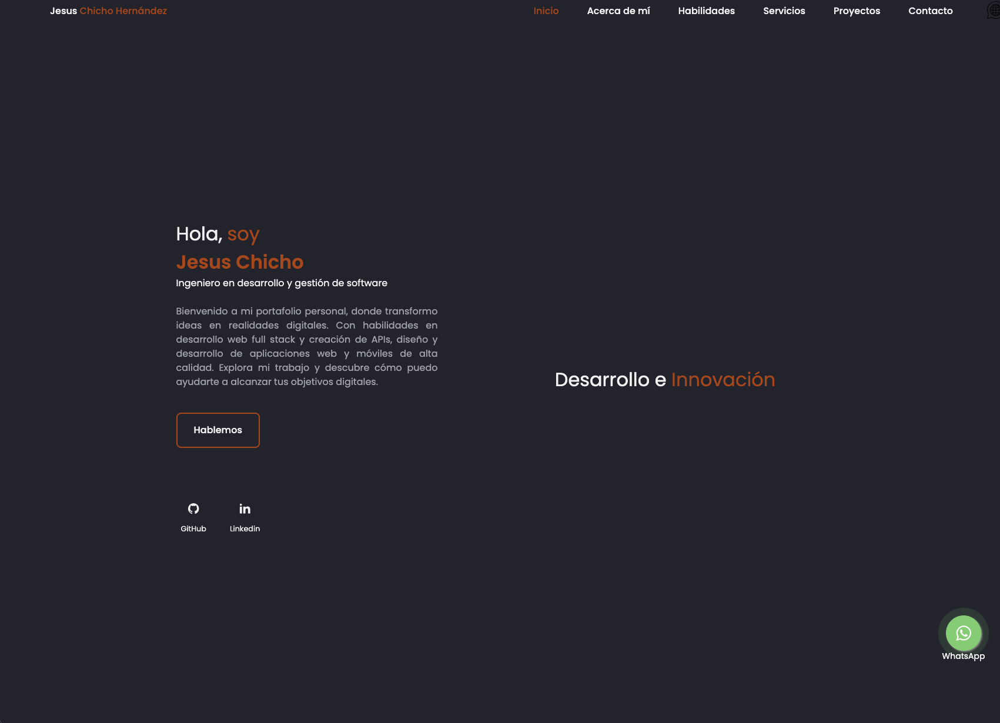
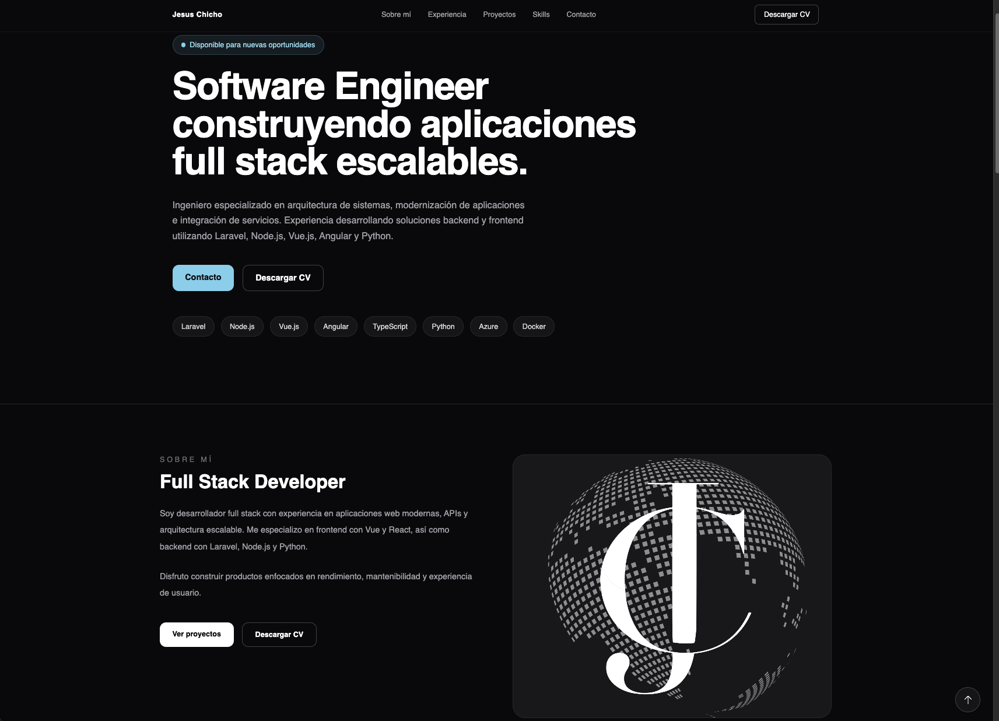

# Personal Portfolio (Nuxt 4)

## Description

This is a personal portfolio project built with **Nuxt 4, Vue 3, and TailwindCSS**, focused on showcasing professional experience, projects, and technical skills as a Full Stack Software Engineer.

It represents an evolution from a previous HTML/CSS/JavaScript version into a modern component-based architecture, improving scalability, maintainability, and performance.

## Live Site

[chichohdz.com](https://chichohdz.com)

The previous Netlify hostname redirects to this domain through `netlify.toml`.

## Tech Stack

- Nuxt 4
- Vue 3
- TypeScript
- TailwindCSS
- Netlify

## Key Features

- Modular architecture using reusable Vue components
- Responsive mobile-first design
- SEO optimization (meta tags, Open Graph, Twitter Cards)
- Improved performance and project structure
- Clean UI focused on usability and user experience
- Continuous deployment via Netlify CI/CD
- Technical profile at `/` and professional services at `/services`
- Shared CV actions: in-page preview, direct download, and opening in another tab
- Privacy/cookie information and optional Analytics consent controls

## Project Documentation

| Document | Purpose |
|---|---|
| [AGENTS.md](../AGENTS.md) | Shared instructions for AI assistants, workflow, and validation |
| [Status](./project/STATUS.md) | Delivered work, active scope, and pending items |
| [Architecture](./architecture/README.md) | Routes, components, CV, modules, and hosting |
| [Deployment](./deployment/README.md) | Review before release, previews, and production promotion |
| [Privacy inventory](./privacy/README.md) | Technical inventory and implemented controls |
| [Account checks](./privacy/ACCOUNT-CHECKLIST.md) | Confirmed GA4/Netlify settings and real checks after deployment |
| [Privacy review](./privacy/REVIEW.md) | Content review, decisions, and pending legal matters |
| [Testing](./testing/README.md) | Unit tests, reproducible browser checks, and screenshot evidence |

The shared maintenance documentation is in Spanish. `CLAUDE.md` and `GEMINI.md` reference `AGENTS.md`. The privacy inventory is internal project documentation, not the published privacy notice.

## Project Structure

```
app/
├── components/
│   ├── layout/
│   ├── privacy/
│   ├── sections/
│   ├── services/
│   └── ui/
├── composables/
├── pages/
├── plugins/
├── utils/
├── layouts/
├── assets/
└── app.vue

public/           CV PDF, screenshots, and other public assets
docs/             architecture, status, privacy, testing, and English documentation
tests/            preference unit tests using node:test
scripts/          Chrome privacy checks with a synthetic tag
nuxt.config.ts    modules, SEO, domain, and Nitro preset
netlify.toml      redirect from the previous hostname
```

## Redesign Purpose

- Migrate from static HTML/CSS/JS to a modern Nuxt-based architecture
- Improve maintainability and scalability
- Enhance component structure and reuse
- Improve UI consistency and user experience

## Screenshots

### Before (HTML/CSS/JS version)


### After (Nuxt 4 version)


## Check performance

Run a fresh measurement for the current domain with [PageSpeed Insights](https://pagespeed.web.dev/). Files under `docs/screenshots/` are historical redesign references, not new measurements for every release.

## Spanish Documentation

The Spanish version of this documentation is available in:

- [Readme](../README.md)

## Local Development

Use a Node.js version compatible with the project's Nuxt dependencies and npm. The repository does not currently pin Node through `.nvmrc` or `engines`; verify compatibility before installation. See the [official Nuxt prerequisites](https://nuxt.com/docs/4.x/getting-started/installation).

This example clones the public repository. The regular contribution workflow uses a checkout with the Bitbucket and GitHub remotes described below.

```bash
git clone https://github.com/JesusLBS/personal-portfolio-website.git
cd personal-portfolio-website
npm ci
npm run dev
```

The development URL is normally `http://localhost:3000`. Run project commands from the repository root.

### Analytics Configuration

[`.env.example`](../.env.example) lists three public runtime variables: `NUXT_PUBLIC_ANALYTICS_ENABLED` (false by default), `NUXT_PUBLIC_GTAG_ID` and `NUXT_PUBLIC_PRIVACY_ADDRESS`. The switch enables privacy controls; tracking additionally needs a valid ID, a production build and valid consent. Without an ID, an enabled preview can show the UI without loading Google. The development server never loads Analytics.

An empty address displays only the general location from the CV. This option omits the legally required notification address; document the limitation instead of claiming full compliance. A complete address can be supplied in Netlify without changing source code. Public runtime values remain visible on the website: this removes the literal from Git, not from the rendered notice. Redeploy after changing deployment variables.

The [inventory](./privacy/README.md) describes both modes and the [account record](./privacy/ACCOUNT-CHECKLIST.md) preserves owner-confirmed settings. Never commit real addresses, private credentials or local environment files.

## Commands and Validation

| Command | Purpose |
|---|---|
| `npm ci` | Install dependencies from the lockfile in a prepared checkout |
| `npm run dev` | Start the development server |
| `npm run build` | Build with the configured Netlify Nitro preset |
| `npm run generate` | Static generation; not the normal deployment workflow |
| `npm run preview` | Nuxt's preview script; verify compatibility with the preset's build artifacts before relying on it for a specific check |
| `npm run test:privacy` | Preference policy tests using Node's test runner; requires support for `--experimental-strip-types` |
| `npm run test:privacy:browser` | Chrome integration with a synthetic tag against a local production build; see the testing setup |

There are currently no lint, formatting, or standalone typecheck scripts in `package.json`. Unit tests cover validation, expiration, cookie selection, and storage failures. The [testing guide](./testing/README.md) explains reproducible browser scenarios and the limits of screenshots and reports. Documentation-only changes require path, link, and consistency checks plus `git diff --check`.

The `/privacidad` and `/cookies` pages, banner, and footer preferences describe and control optional analytics. The technical implementation does not certify legal compliance; account settings are documented; the default general location does not fulfill the legal address requirement, and deployment checks depend on the selected Analytics mode.

Responsive checks cover direct loading, reloading, navigation from `/services`, the menu, and CV actions at 320, 390, 768, 1024, and 1440 px. Consent checks require a production-equivalent build and a test tag, since development does not load Analytics.

## Deployment

Bitbucket owns the PR and deployment workflow. GitHub provides the public copy of the main branches.

| Remote or branch | Role |
|---|---|
| `origin` | Bitbucket; work branches and PRs |
| `github` | GitHub; synchronized `develop` and `master` branches |
| `develop` | Reviewed integration work |
| `master` | Production; linked to Netlify deployment according to the owner-confirmed workflow |

Create work branches from `develop` and push them only to Bitbucket. Merge into `develop` through a PR. Before merging the `develop` → `master` PR, review its Deploy Preview following the [deployment workflow](./deployment/README.md). A permanent develop URL is an optional alternative that has not been enabled. Synchronize the integrated main branches to GitHub:

```zsh
# From the work branch; replace the example branch name.
git push -u origin feature/my-change

# After merging the PR into develop in Bitbucket.
git switch develop
git pull --ff-only origin develop
git push github develop

# After merging the develop-to-master PR in Bitbucket.
git switch master
git pull --ff-only origin master
git push github master
```

Check local status before switching branches and preserve pending work. Investigate divergence instead of force-pushing.

The Nitro preset is `netlify`. Repository linkage, the production branch, preview contexts, and deployment variables are managed in Netlify. `netlify.toml` only declares the redirect from the previous hostname. Netlify builds deployment artifacts; a local macOS build validates changes and is not manually uploaded to replace that workflow.

## License

All rights reserved. Copyright © 2026 Jesús Chicho Hernández.

This project is for personal use only. It is not permitted to copy, modify, distribute, sublicense, sell, or use the code, design, resources, or documentation for commercial or redistribution purposes without the author's prior written authorization.

The software and its content are protected by applicable copyright and intellectual property laws.
